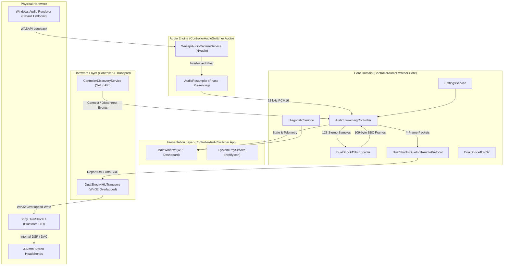

# ControllerAudioSwitcher: System Architecture

## Architecture Overview

`ControllerAudioSwitcher` is designed with strict separation of concerns, ensuring that the audio capture pipeline, hardware discovery, audio codec, and Bluetooth HID transport remain fully decoupled and independently testable without physical hardware.

---

## Component Breakdown

### 1. Presentation Layer (`ControllerAudioSwitcher.App`)
- **Technology**: Windows Presentation Foundation (WPF) on .NET 8.0, styled with a Windows 11 dark theme.
- **Responsibilities**:
  - Displays real-time controller connectivity, hardware revision, and capability status.
  - Exposes playback audio source selector, volume slider (0–127), and operational toggles.
  - Renders live audio telemetry: packet counters, buffer depth, estimated latency, underruns.
  - Manages system tray integration (`NotifyIcon`), minimizing to tray on window close, and restoring on double-click.

### 2. Core Domain (`ControllerAudioSwitcher.Core`)
- **`AudioStreamingController`**:
  - The central coordinator managing stream lifecycle, pre-buffering (priming), and synchronization.
  - Spawns a dedicated high-priority background transmission thread (`DualShock4-Audio-Transmitter`) operating on a precise 16 ms cadence.
  - Manages a concurrent jitter buffer (`ConcurrentQueue<byte[]>`) with a ceiling of 64 frames (~256 ms) to prevent unbounded latency growth while absorbing dispatch variance.
- **`DualShock4BluetoothAudioProtocol`**:
  - Encapsulates the binary report structure for Report `0x11` (Arm/Disarm) and Report `0x17` (Audio Stream).
  - Enforces the `0xA0` mode flag and `0x24` headphone target opcode.
- **`DualShock4Crc32`**:
  - Fast table-driven IEEE 802.3 CRC-32 generator prepending `0xA2` Bluetooth report identifier.
- **`DualShock4SbcEncoder`**:
  - Pure C# subband codec encoding 128 stereo PCM samples into 109-byte SBC frames.
- **`SettingsService` & `DiagnosticService`**:
  - Handles JSON serialization of user configuration (`%LOCALAPPDATA%\ControllerAudioSwitcher\settings.json`) and thread-safe diagnostic logging.

### 3. Audio Engine (`ControllerAudioSwitcher.Audio`)
- **`WasapiAudioCaptureService`**:
  - Captures default or user-selected Windows playback device output using NAudio's WASAPI Loopback API.
  - Automatically recovers from format changes and handles clean teardown.
- **`AudioResampler`**:
  - Resamples arbitrary input sample rates (e.g., 48,000 Hz or 44,100 Hz 32-bit float) to exactly 32,000 Hz 16-bit PCM.
  - Preserves fractional phase across packet buffers to prevent pops and distortion.

### 4. Controller & Transport Layer (`ControllerAudioSwitcher.Controller` & `Transport`)
- **`ControllerDiscoveryService`**:
  - Uses Win32 SetupAPI (`SetupDiGetClassDevs`, `SetupDiEnumDeviceInterfaces`) and HID API (`HidD_GetAttributes`) to enumerate physical controllers.
  - Distinguishes between USB connections (Input report length = 64 bytes) and Bluetooth connections (Input report length >= 78 bytes).
  - Filters genuine Sony controllers (VID `0x054C`, PID `0x05C4` for v1 and `0x09CC` for v2).
- **`DualShock4HidTransport`**:
  - Opens communication handles with `GENERIC_READ | GENERIC_WRITE`, `FILE_SHARE_READ | FILE_SHARE_WRITE`, and `FILE_FLAG_OVERLAPPED`.
  - Configures HID driver ring-buffer capacity using `HidD_SetNumInputBuffers(handle, 2)` to eliminate I/O queue stalls.
  - Issues non-blocking asynchronous `WriteFile` calls with timeout guards to prevent UI or transmission thread hangs.

---

## Threading & Latency Architecture

1. **WASAPI Capture Thread**: Owned by Windows Core Audio / NAudio, fires event callbacks whenever a sound card buffer is filled (typically every 10 ms).
2. **Resample & Encode Pipeline**: Executed inside `OnCaptureSamplesAvailable`. Audio chunks are resampled and encoded immediately into 109-byte SBC frames and pushed into the thread-safe `_encodedFrameQueue`.
3. **Transmission Loop Thread**:
   - Runs with `ThreadPriority.AboveNormal`.
   - Regulated by a monotonic high-resolution stopwatch deadline ticking every 16 ms.
   - Dequeues exactly 4 frames per interval and transmits the 462-byte Report `0x17`.
   - Inserts silence frames on buffer underrun to keep the controller DSP locked without audio glitching.
4. **UI Thread**: Receives state updates via WPF `Dispatcher.Invoke`. Real-time telemetry is throttled to 250 ms intervals to ensure near-zero UI overhead.
